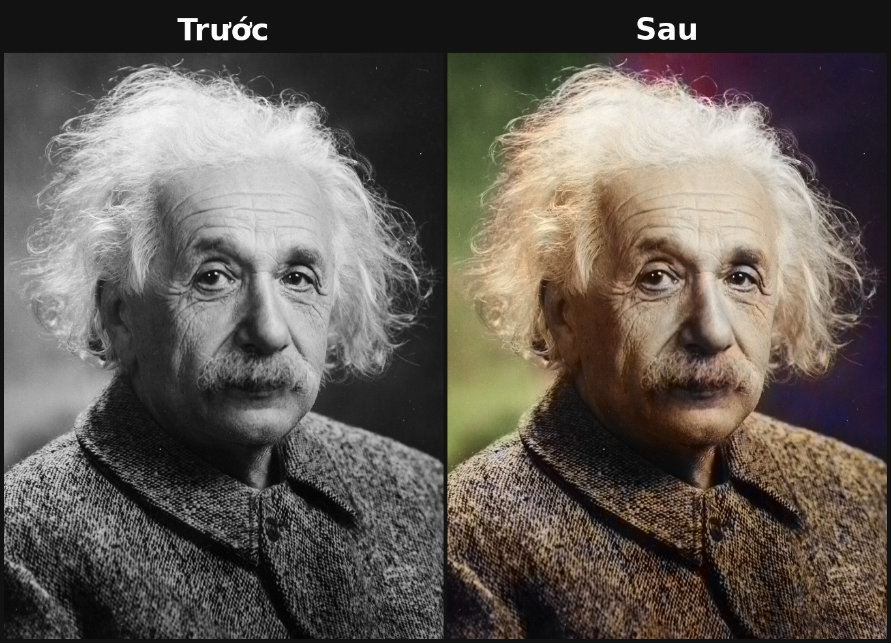

# 🎨 tomau — Tô màu ảnh đen trắng cũ, offline & miễn phí

**tomau** biến ảnh đen trắng cũ (ảnh ông bà, ảnh gia đình, ảnh lịch sử) thành ảnh màu chỉ trong vài giây.
Chạy hoàn toàn trên máy của bạn — không cần Internet sau khi tải model, không gửi ảnh lên server nào, không tốn phí, không giới hạn số ảnh.


## Tính năng

- Tô màu tự động bằng mạng nơ-ron (OpenCV DNN, chạy bằng CPU, ~0,5–2 giây/ảnh).
- Dòng lệnh: tô **1 ảnh** hoặc **cả thư mục** một lần.
- Giao diện web nhỏ: kéo ảnh vào, bấm "Tô màu", tải kết quả về.
- Tự xuất **ảnh so sánh Trước | Sau** đặt cạnh nhau (nhãn tiếng Việt có dấu) — đăng mạng xã hội ngay.
- Nút chỉnh **độ đậm màu** (`--strength`): 0 = giữ đen trắng, 1 = mặc định, 1.3–1.5 = màu rực hơn.
- Giữ nguyên độ phân giải và chi tiết của ảnh gốc (chỉ thêm màu, không làm mờ ảnh).

## Cài đặt

Yêu cầu: Python 3.9+ (Windows / macOS / Linux).

```bash
git clone https://github.com/vietphan98/tomau.git
cd tomau
python -m venv .venv
# Windows: .venv\Scripts\activate    |   macOS/Linux: source .venv/bin/activate
pip install -r requirements.txt

# Tải model (~125 MB, chỉ cần 1 lần, có kiểm tra checksum)
python download_models.py
```

Model được lưu vào thư mục `models/` (đổi chỗ khác bằng `python download_models.py --dir <thư mục>` và đặt biến môi trường `TOMAU_MODELS=<thư mục>`).

> Lưu ý: cần `opencv-python(-headless)` bản 4.x (OpenCV 5 bỏ hỗ trợ đọc model Caffe) — `requirements.txt` đã ghim sẵn.

## Cách dùng

### Dòng lệnh

```bash
# Tô màu 1 ảnh -> ket_qua/anh_ong_ba_tomau.jpg + ket_qua/anh_ong_ba_so_sanh.jpg
python -m tomau anh_ong_ba.jpg

# Tô màu cả thư mục, lưu vào thư mục khác
python -m tomau album_cu/ -o album_mau/

# Màu đậm hơn một chút
python -m tomau anh_ong_ba.jpg -s 1.3

# Không cần ảnh so sánh
python -m tomau album_cu/ --no-compare
```

| Tuỳ chọn | Ý nghĩa |
|---|---|
| `-o, --output` | Thư mục lưu kết quả (mặc định `ket_qua`) |
| `-s, --strength` | Độ đậm màu (mặc định `1.0`) |
| `--no-compare` | Không xuất ảnh so sánh Trước/Sau |
| `--models` | Thư mục chứa model |

### Giao diện web

```bash
python app.py            # hoặc: python app.py --port 8080
```

Mở trình duyệt tại <http://127.0.0.1:5000>, chọn ảnh, kéo thanh "Độ đậm màu", bấm **Tô màu**. Kết quả hiện ngay dạng Trước | Sau, có nút tải ảnh màu và ảnh so sánh.

### Dùng trong code Python

```python
import cv2
from tomau import Colorizer, make_comparison
from tomau.core import to_gray_bgr

col = Colorizer()
img = cv2.imread("anh_cu.jpg")
mau = col.colorize(img, strength=1.2)
cv2.imwrite("anh_mau.jpg", mau)
cv2.imwrite("so_sanh.jpg", make_comparison(to_gray_bgr(img), mau))
```

## Ví dụ

| Ảnh gốc | Kết quả |
|---|---|
| [examples/dau_vao/migrant_mother.jpg](examples/dau_vao/migrant_mother.jpg) | [examples/ket_qua/migrant_mother_so_sanh.jpg](examples/ket_qua/migrant_mother_so_sanh.jpg) |
| [examples/dau_vao/einstein.jpg](examples/dau_vao/einstein.jpg) | [examples/ket_qua/einstein_so_sanh.jpg](examples/ket_qua/einstein_so_sanh.jpg) |



Nguồn ảnh mẫu (đều là **public domain**, lấy từ Wikimedia Commons):
- *Migrant Mother* — Dorothea Lange, 1936 (Library of Congress): <https://commons.wikimedia.org/wiki/File:Lange-MigrantMother02.jpg>
- *Albert Einstein* — Orren Jack Turner, 1947: <https://commons.wikimedia.org/wiki/File:Albert_Einstein_Head.jpg>

## Demo (quay video 20–30 giây)

Mục tiêu: người xem thấy rõ ảnh **đen trắng → có màu** trong vài giây đầu.

1. **Chuẩn bị**: 2–3 ảnh đen trắng cũ thật (ảnh ông bà, ảnh gia đình xưa — chụp lại bằng điện thoại cũng được) để trong thư mục `album_cu/`. Mở sẵn `python app.py` trên trình duyệt, phóng to cửa sổ.
2. **0–3s (hook)**: cầm tấm ảnh đen trắng thật trên tay đưa vào khung hình, chèn chữ câu hook.
3. **3–12s**: trên web, chọn ảnh → bấm **Tô màu** → ảnh Trước | Sau hiện ra (quay cận màn hình, để thấy chỉ mất 1–2 giây).
4. **12–20s**: kéo thanh "Độ đậm màu" lên 1.4 và bấm lại để thấy màu rực hơn; hoặc mở terminal chạy `python -m tomau album_cu/` để tô cả album một lần.
5. **20–30s**: lướt nhanh qua các ảnh `*_so_sanh.jpg` trong thư mục kết quả (hiệu ứng trượt/zoom từ trái sang phải), kết bằng chữ: "Miễn phí, chạy offline — link GitHub ở bình luận".

**Câu hook gợi ý cho Reel:**
> "Ảnh đen trắng của ông bà mình, 2 giây sau đã có màu — miễn phí, không cần mạng!"

## Cách hoạt động (tóm tắt)

1. Chuyển ảnh sang không gian màu **Lab**; kênh **L** (độ sáng) chính là ảnh đen trắng.
2. Thu nhỏ kênh L về 224×224 và đưa vào mạng nơ-ron; mạng dự đoán 2 kênh màu **a, b**.
3. Phóng kênh a, b về kích thước gốc, nhân với hệ số độ đậm, ghép lại với kênh L **gốc** → ảnh màu giữ nguyên chi tiết.

## Giấy phép & ghi công

- Mã nguồn **tomau**: MIT © 2026 Việt Phan — xem [LICENSE](LICENSE).
- **Model tô màu không thuộc về dự án này.** Model là của các tác giả bài báo
  *"Colorful Image Colorization"* — Richard Zhang, Phillip Isola, Alexei A. Efros (ECCV 2016),
  phân phối theo giấy phép **BSD-2-Clause** của họ: <https://github.com/richzhang/colorization>.
  Repo này không chứa file model; `download_models.py` tải chúng từ nguồn công khai khi bạn chạy.
- Màu do AI dự đoán nên có thể không đúng với màu thật năm xưa — hãy xem đây là bản "phục dựng tham khảo".

Tác giả: **Việt Phan**
